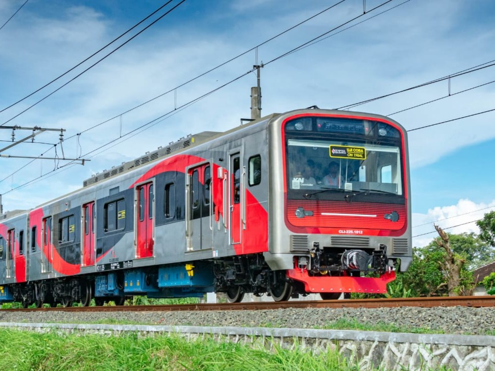

# 🚉 KRL Schedule Processing

[](https://www.python.org/)
[](https://www.kci.id/layanan/info-pelanggan/jadwalcommuterline-gapeka2026)
[](#quickstart)
[](LICENSE)

A Python CLI and data pipeline that converts official Indonesian **KRL Commuter Line (GAPEKA)** timetable PDFs (or fallback CSVs) into validated, structured **JSON** and queryable **SQLite** datasets.




### Download the Official GAPEKA PDF

Official KAI Commuter timetable PDFs (`data/raw/`) and generated outputs (`data/output/`) are **intentionally excluded from Git** and are not redistributed in this repository.

To run the pipeline locally:

1. Visit the official KAI Commuter Customer Information page:
   - **Customer Info / Schedules Hub**: https://www.kci.id/layanan/info-pelanggan
   - **Latest Schedule (GAPEKA 2026)**: https://www.kci.id/layanan/info-pelanggan/jadwalcommuterline-gapeka2026
2. Download the official Commuter Line timetable PDF(s).
3. Drop the downloaded PDF file(s) (or optional CSV fallback files) into `data/raw/`.

---

### What It Does

- **Extracts GAPEKA tables** from bordered PDFs (multi-page & multi-line) or fallback CSVs, auto-detecting line and direction.
- **Normalizes stations & routes** via `data/stations.json`, resolving both 3–4 letter codes (`CKR`, `MRI`, `SUDB`) and uppercase PDF headers (`BANDARA SOEKARNO-HATTA`, `BNI CITY`).
- **Fixes timetable quirks** — zero-pads `HH:MM` with midnight rollover, preserves `Ls` (*Langsung*) as `status: "pass"`, and structures operational `remarks` (Full Racket leg pairs, holiday cancellations, partial service).
- **Exports & audits** per-line JSON (`+ manifest.json`) and an indexed SQLite DB, flagging unmapped stations, backwards times, or duplicates.

---

### Out of The Box

| Layer | Stack | Purpose |
| :--- | :--- | :--- |
| **Extraction** | `pdfplumber` | Line-based grid extraction & multi-page table stitching |
| **Schemas** | `pydantic` (v2) | Strict timetable data contracts & JSON serialization |
| **CLI & UI** | `typer`, `rich` | `build`, `validate`, and `inspect` commands with table previews |
| **Storage** | `sqlite3` (stdlib) | Indexed `stations`, `trains`, and `stop_times` queryable DB |
| **Quality** | `pytest`, `ruff` | Synthetic-fixture test suite, linting, and formatting |

```text
krl-schedule-processing/
├── assets/
│   ├── cikarang-schedule-preview.png  # GAPEKA table crop
│   └── krl-from-inka.jpeg             # Header image
├── data/
│   ├── raw/                           # [gitignored] GAPEKA PDFs/CSVs
│   ├── output/                        # [gitignored] JSON & SQLite outputs
│   └── stations.json                  # Station codes & aliases
├── src/krl_schedule/
│   ├── cli.py                         # CLI commands
│   ├── models.py                      # Pydantic schemas
│   ├── stations.py                    # Station alias resolver
│   ├── pipeline.py                    # Pipeline runner
│   ├── validate.py                    # Timetable auditor
│   ├── extract/                       # PDF & CSV loaders
│   ├── transform/                     # Time, route & stop parsers
│   └── export/                        # JSON & SQLite writers
├── tests/                             # Unit & CLI tests (no PDF needed)
├── processing.ipynb                   # Legacy notebook
└── pyproject.toml                     # Package & tool config
```

---

### Quickstart

Requires **Python 3.11+**.

```bash
# start with installing
uv venv && uv pip install -e ".[dev]" # (or: python -m venv .venv && pip install -e ".[dev]")

# then try to build JSON + SQLite from data/raw/
krl-schedule build --input data/raw --output data/output

# and finally, validate & preview
krl-schedule validate data/output
krl-schedule inspect data/output/cikarang_from_cikarang.json --limit 10
```

> **Build flags:** `--formats json|sqlite`, `--include-empty-stops`, `--dump-raw-csv`, `--strict`, `--verbose`.

#### Example Output Record

```json
{
  "no": 3,
  "train_number": "5505B",
  "line": "cikarang",
  "direction": "from_cikarang",
  "route_raw": "Ckr-Mri-Kpb",
  "route_label": "Cikarang - Kampung Bandan via Manggarai",
  "route": {
    "origin": "CKR",
    "destination": "KPB",
    "via": ["MRI"]
  },
  "remarks": {
    "raw": "Full Racket",
    "type": "full_racket",
    "note": "",
    "operates_on_holidays": true,
    "next_train_number": "5506",
    "next_route": "Kpb-Pse-Bks"
  },
  "stops": [
    { "code": "CKR", "name": "Cikarang", "time": "04:28", "status": "stop" },
    { "code": "JNG", "name": "Jatinegara", "time": "05:11", "status": "stop" },
    { "code": "KPB", "name": "Kampung Bandan", "time": "05:51", "status": "stop" },
    { "code": "JAKK", "name": "Jakarta Kota", "time": null, "status": "pass" }
  ]
}
```

#### Example SQLite Query

> *Find the next departures from **Manggarai (`MRI`)** after `17:30`*

```sql
SELECT t.train_number, t.route_label, s.departure_time, t.operates_on_holidays
FROM trains t
JOIN stop_times s ON s.train_id = t.id
WHERE s.station_code = 'MRI'
  AND s.status = 'stop'
  AND s.minutes_since_midnight >= (17 * 60 + 30)
ORDER BY s.minutes_since_midnight ASC
LIMIT 10;
```

---

### Running Tests & Quality Checks

```bash
ruff check src tests
ruff format --check src tests
pytest -v
```

* The test suite uses lightweight synthetic fixtures in `tests/fixtures/` and runs without requiring the official GAPEKA PDF.

---

Released under the [MIT License](LICENSE).
