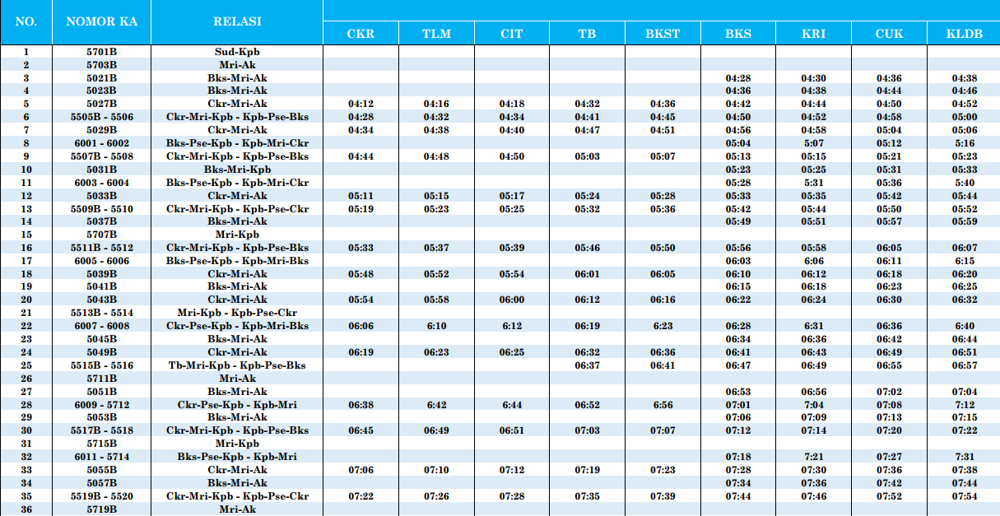

# 🚆 KRL Schedule Processing

This project processes Indonesian **KRL Commuter Line** train schedules from csv into structured JSON. It is built around one Jupyter Notebook: `processing.ipynb`.





## What it does

  * Reads the original schedule on csv (converted from PDF).
  * Cleans and normalizes station codes.
  * Generates clear route info (e.g., `Cikarang – Kampung Bandan via Manggarai`).
  * Parses `KETERANGAN` into compact, structured notes (e.g., holiday schedule, full racket, etc.).
  * Exports per-line schedules into `json/krl-schedule/`.
  * Previews the first 10 rows of each file in table format.


## Files & Folders

```
assets/                     # images and references
├── krl-header.jpg
└── official-schedule-crop-1.jpg
csv                         # input for processing
├── krl-schedule - from-bogor.csv
├── krl-schedule - from-cikarang.csv
├── krl-schedule - to-bogor.csv
└── krl-schedule - to-cikarang.csv
json                        # output of processing
├── krl-schedule            # cleaned JSON schedules
└── station-code
processing.ipynb            # main notebook
```


## Example

A cleaned schedule row looks like this:
```json
{
  "NO":"6",
  "NOMOR_KA":"5505B",
  "RELASI":"Ckr-Mri-Kpb",
  "CLEAN_RELASI":"Cikarang - Kampung Bandan via Manggarai",
  "KETERANGAN":{
    "text":"Full Racket",
    "type":"Full Racket",
    "note":"",
    "next_nomor_ka":"5506",
    "keterangan":"Full Racket"
  },
  "STOPS":[
    {
      "code":"CKR",
      "name":"Cikarang",
      "time":"04:28"
    },
    {
      "code":"JNG",
      "name":"Jatinegara",
      "time":"05:11"
    },
    {
      "code":"KPB",
      "name":"Kampung Bandan",
      "time":"05:51"
    },
    {
      "code":"JAKK",
      "name":"Jakarta Kota",
      "time":""
    }
  ]
}
```


## License

  * **Code**: MIT
  * **Data**: From public KRL timetable (for reference only)
